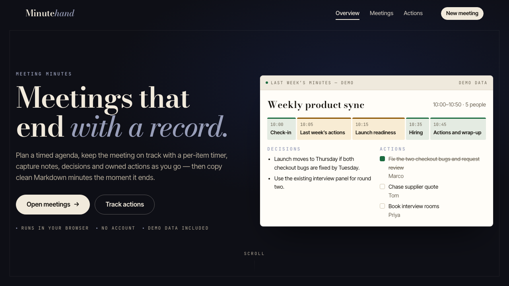
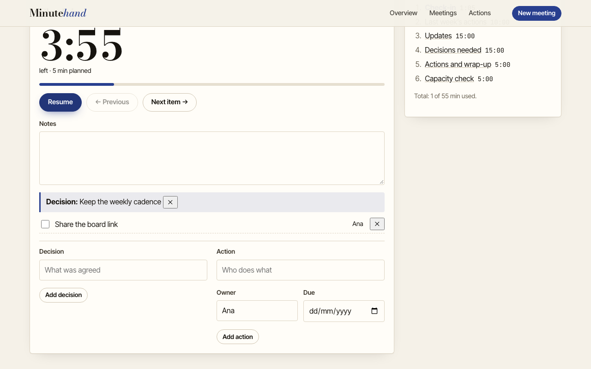
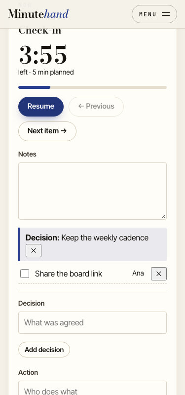

# Minutehand

Meeting minutes with structure: a timed agenda, a run mode with a per-item timer, notes, decisions and owned actions captured against each item, a tracker for open actions across meetings, and clean Markdown minutes to copy or download.

**Live demo:** [https://minutehand.vercel.app/](https://minutehand.vercel.app/) — runs entirely in your browser; demo data is fictional and labelled.



| Run mode | Mobile |
| --- | --- |
|  |  |

## Run it

```bash
npm install
npm run dev        # http://localhost:5214
npm test
npm run build
npm run test:e2e   # Playwright smoke test (npm run e2e:install once if Chromium is missing)
```

## Main workflow

1. The app opens with two labelled, fictional **demo meetings**: last week’s (with notes, decisions, an overdue action and recorded timings) and today’s, ready to run. **Meetings → Clear demo meetings** removes them.
2. **New meeting** → title, date, start time, attendees and an agenda template (weekly, kickoff, retrospective, one-to-one or blank).
3. **Agenda** → add, reorder and remove items with minutes and presenters; planned start times are worked out. Set the location and who is present or absent.
4. **Run meeting** → the current item with a countdown that turns amber in the last minute and red when over time, previous/next, notes, and quick decision and action forms.
5. **Notes & actions** per item, then **Minutes** → preview, **Copy Markdown** or **Download .md**. **Actions** → every action from every meeting, filtered by open/overdue/all and owner, ticked off in place.

## Rules

- Item start times run back to back from the meeting start; times wrap past midnight.
- The minutes show the actual end time once items have been timed, otherwise the planned end.
- Every action needs an owner; an action is overdue when its due date has passed and it isn’t done.
- Markdown export escapes `|` in the actions table and puts decisions under the item they belong to.

## Design

Shared editorial system: Bodoni Moda display type, Inter Tight interface text, mono times, an agenda bar sized by minutes (green when on time, amber when overrun), an ink hero whose preview is real minutes, and a warm paper workspace. Motion is disabled under `prefers-reduced-motion`.

## Tests

- `src/lib/minutes.test.ts` — planned/spent time, end times across the hour and midnight, timed agenda, overrun, clock formatting, cross-meeting actions, name parsing, validation, Markdown output.
- `src/App.test.tsx` — creating from a template, action owner validation, minutes preview, the run-mode timer with fake timers, action tracking.
- `e2e/smoke.spec.ts` — landing, create and plan a meeting, run it with a controlled clock, add a decision and action, download Markdown, reload persistence, plus 375px layout checks.

## Limitations

- No audio recording or transcription.
- One note-taker per meeting; no real-time collaboration.

## Future improvements

- Recurring meetings that carry open actions forward; email-ready HTML export.

## Licence

MIT — see [LICENSE](LICENSE).
